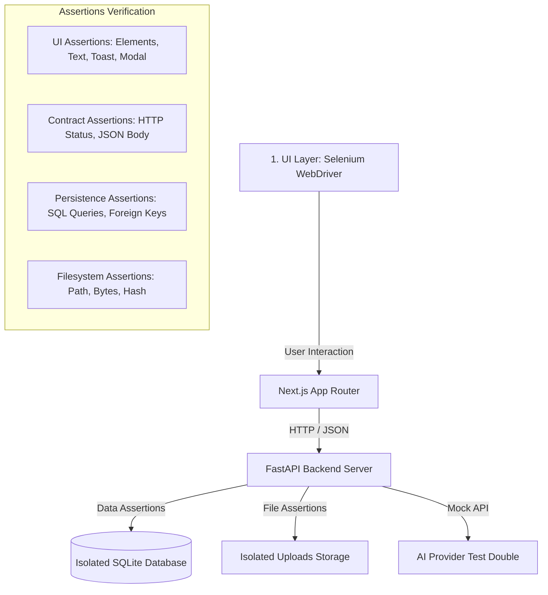

# แผนการทดสอบระบบ (Test Plan) — Narongsak

**โครงการ:** UniResearch — ระบบคลังจัดเก็บและเผยแพร่ผลงานวิชาการส่วนกลาง  
**ผู้จัดทำแผน:** นาย นรงศ์ศักดิ์ ภูมิประเสริฐ (รหัสนักศึกษา 674259009)  
**สาขาวิชา:** วิศวกรรมซอฟต์แวร์ มหาวิทยาลัยราชภัฏนครปฐม  
**บทบาท:** Student / Tester  
**อีเมล:** `674259009@webmail.npru.ac.th`  
**ขอบเขตความรับผิดชอบ:** 18 กรณีทดสอบ (Narongsak 18 Test Cases)  
**ฉบับทบทวน:** 16 ตุลาคม 2026  
**เอกสารอ้างอิง:** [TEST-CASES.md](TEST-CASES.md) · [uniresearch-test-cases-Narongsak.md](uniresearch-test-cases-Narongsak.md) · [TEST-REPORT.md](TEST-REPORT.md) · [uniresearch-test-plan-and-report-Narongsak.md](uniresearch-test-plan-and-report-Narongsak.md) · [UI-TEST-EXECUTION.md](UI-TEST-EXECUTION.md) · [TESTING-GUIDE.md](TESTING-GUIDE.md)

---

## 1. บทนำและวัตถุประสงค์ (Introduction & Objectives)

เอกสารแผนการทดสอบฉบับนี้จัดทำขึ้นเพื่อกำหนดแนวทาง กลยุทธ์ ขอบเขต สภาพแวดล้อม และเกณฑ์การประเมินผล สำหรับการทดสอบระบบ UniResearch ในส่วนงานที่ได้รับมอบหมายของ **นาย นรงศ์ศักดิ์ ภูมิประเสริฐ** จำนวน **18 กรณีทดสอบหลัก (18 Test Cases)**

### วัตถุประสงค์หลัก (Key Objectives)
1. **ยืนยันความถูกต้องเชิงฟังก์ชัน (Functional Correctness):** ตรวจสอบว่าระบบทำงานได้ตรงตามข้อกำหนดความต้องการเชิงฟังก์ชัน (FR-001 ถึง FR-032 ในส่วนที่ครอบคลุม 17 FRs)
2. **ตรวจสอบการควบคุมสิทธิ์ตามบทบาท (RBAC Verification):** ยืนยันความปลอดภัยของการเข้าถึงข้อมูลระหว่าง 4 บทบาทหลัก (Guest, Student, Advisor, Admin) และป้องกันการยกระดับสิทธิ์ (Privilege Escalation)
3. **ตรวจสอบความสมบูรณ์ของข้อมูลและไฟล์ (Data & File Integrity):** ยืนยันการจัดเก็บข้อมูลผลงานวิจัย ประวัติเวอร์ชันไฟล์แก้ไข (`FileRevision`) และการป้องกันไฟล์เดิมสูญหาย
4. **ทดสอบประสบการณ์ผู้ใช้งานจริงผ่าน UI (End-to-End User Journey):** ทดสอบปฏิสัมพันธ์บนหน้าจอเว็บเบราว์เซอร์ด้วย Selenium WebDriver บนสภาพแวดล้อมจำลองเสมือนจริง

---

## 2. ขอบเขตการทดสอบ (Testing Scope)

### 2.1 ขอบเขตที่ต้องทดสอบ (In-Scope: 18 Test Cases)

ชุดการทดสอบครอบคลุม 9 หมวดหมู่หลัก จำนวน 18 กรณีทดสอบ:

| หมวดหมู่ (Category) | Test Case IDs | จำนวน | รายละเอียดขอบเขต |
|---|---|:---:|---|
| **AUTH** (การยืนยันตัวตน) | TC-001, TC-004, TC-007 | 3 | การสมัครสมาชิก, การป้องกันสิทธิ์ admin, การปฏิเสธรหัสผ่านผิด, และการล้าง Session เมื่อ Logout |
| **CATEGORY** (หมวดหมู่) | TC-010 | 1 | การสร้างหมวดหมู่โดย Admin และการมองเห็นของบุคคลทั่วไป |
| **USER** (ตัวเลือกและสิทธิ์) | TC-013 | 1 | การป้องกันนักศึกษาไม่ให้แก้ไขตัวเลือกส่วนกลางของระบบ |
| **RECOMMENDATION** (คำแนะนำ) | TC-016 | 1 | การค้นหาและ Search Suggestions ต้องไม่รั่วไหลงานรอตรวจสอบ |
| **SUBMISSION** (การส่งผลงาน) | TC-019, TC-022, TC-025, TC-028, TC-031, TC-034 | 6 | หน้าผลงานไม่พบ (404), การส่งผลงาน 5 ขั้นตอน, การตรวจรุ่นนักศึกษา, หน้ารวมผลงานของฉัน, การส่งไฟล์แก้ไขและเก็บประวัติเวอร์ชัน, การดาวน์โหลดและนับสถิติ |
| **REVIEW** (การประเมินผลงาน) | TC-037, TC-038 | 2 | ประวัติการตรวจเฉพาะบุคคลของอาจารย์, การอนุมัติผลงานจากคิวตรวจพร้อมให้คะแนน |
| **NOTIFICATION** (การแจ้งเตือน) | TC-043 | 1 | การอ่านและทำเครื่องหมายอ่านแจ้งเตือนส่วนบุคคล |
| **AI** (ระบบปัญญาประดิษฐ์) | TC-046 | 1 | AI ช่วยตรวจงานวิจัย 4 แท็บในหน้าอาจารย์ และการตรวจสิทธิ์ Endpoint |
| **E2E** (การทำงานครบวงจร) | TC-047, TC-048 | 2 | Flow ข้ามบทบาท: นักศึกษาส่งงาน -> อาจารย์อนุมัติ -> เผยแพร่ และ Admin จัดการระบบ |
| **รวมทั้งสิ้น** | | **18** | ครอบคลุม Positive 13 เคส / Negative & Boundary 5 เคส |

### 2.2 ความต้องการเชิงฟังก์ชันที่ครอบคลุม (Functional Requirements Coverage)

ครอบคลุม 17 ความต้องการเชิงฟังก์ชันของระบบ:
- `FR-001`, `FR-002`, `FR-004`: การลงทะเบียน เข้าสู่ระบบ และจัดการเซสชัน
- `FR-006`, `FR-007`: การจัดการหมวดหมู่และตัวเลือกส่วนกลาง
- `FR-009`, `FR-011`: คำแนะนำการค้นหาและหน้ารายละเอียดงาน
- `FR-014`, `FR-015`, `FR-017`, `FR-019`, `FR-021`: การส่งผลงาน, การตรวจผู้จัดทำ, ผลงานของฉัน, การจัดการเวอร์ชัน, และการดาวน์โหลด
- `FR-023`, `FR-024`: ประวัติการประเมินและการอนุมัติงานวิจัย
- `FR-028`: ระบบแจ้งเตือน
- `FR-031`, `FR-032`: AI ตรวจผลงาน และการเชื่อมโยงข้ามบทบาทแบบ End-to-End

### 2.3 สิ่งที่อยู่นอกขอบเขต (Out-of-Scope)
- การทดสอบประสิทธิภาพภายใต้การรับโหลดสูง (Load / Stress Testing)
- การเจาะระบบความปลอดภัยขั้นสูงเต็มรูปแบบ (Penetration Testing)
- การประเมินคุณภาพความฉลาดทางภาษาของโมเดล AI ในเชิงเนื้อหาวิชาการ (ใช้ Deterministic Test Double / Mock เพื่อยืนยันความถูกต้องของ Contract และ UI Data Flow)
- กรณีทดสอบนอกเหนือจาก 18 กรณีที่ได้รับมอบหมาย (อีก 30 กรณีเป็นความรับผิดชอบของสมาชิกท่านอื่นในทีม)

---

## 3. กลยุทธ์และวิธีการทดสอบ (Testing Strategy)

การทดสอบใช้กลยุทธ์การทดสอบแบบหลายระดับ (Multi-layered Verification) เพื่อให้มั่นใจทั้งด้านหน้าจอและการทำงานเบื้องหลัง:

### 3.1 ระดับการทดสอบ (Test Levels)
1. **UI Automation Layer (Selenium WebDriver):**
   - ใช้โครงสร้าง Page Object Model (POM) ผ่าน [`pages.py`](../../../tests/selenium/pages.py) และ [`support.py`](../../../tests/selenium/support.py)
   - ใช้ `WebDriverWait` ร่วมกับ Explicit Waits (ไม่ใช้ `time.sleep` ในการรอองค์ประกอบของเบราว์เซอร์)
   - ดำเนินการผ่านเบราว์เซอร์ Google Chrome ทั้งโหมดเปิดหน้าต่าง (`--headed`) เพื่อสังเกตการณ์ และโหมดพื้นหลัง (`--headless`) สำหรับ CI/Automated
   - บันทึกภาพถ่ายหน้าจอ (Screenshots) อัตโนมัติในทุกขั้นตอนสำคัญและเมื่อเกิดข้อผิดพลาด
2. **API & Contract Verification Layer:**
   - ส่งคำขอ HTTP ผ่าน client จำลอง (`httpx`) ควบคู่กับ UI เพื่อตรวจสอบ Status Code (เช่น 200, 400, 403, 404, 422)
   - ตรวจสอบความปลอดภัยของ Header, Cookies (`HttpOnly`), และ Payload
3. **Database & Storage Layer:**
   - ใช้ฐานข้อมูล SQLite ชั่วคราวแยกเฉพาะแต่ละกรณีทดสอบ (Isolated Disposable DB)
   - ตรวจสอบ Foreign Key Relations, การอัปเดต Counter, และการคงอยู่ของข้อมูล
   - ตรวจสอบขนาดไฟล์ (File Size) และ Signature ไบต์ของเอกสาร PDF และรูปภาพ

---

## 4. สภาพแวดล้อมและเครื่องมือที่ใช้ (Test Environment & Tools)

| องค์ประกอบ | รายละเอียดสภาพแวดล้อมที่รองรับ |
|---|---|
| **ระบบปฏิบัติการ (OS)** | macOS (Apple Silicon / ARM64) / Linux Ubuntu 22.04+ |
| **ภาษาและรันไทม์ (Runtime)** | Python 3.11+ / 3.14, Node.js 20.9.0+ / Node.js 22 |
| **ระบบจัดการแพ็กเกจ** | `pip`, `pnpm` (v9+) |
| **เว็บเฟรมเวิร์กหน้าบ้าน** | Next.js 16.2.12 (React 19.2.4) รันบนพอร์ตทดสอบ loopback อัตโนมัติ |
| **เว็บเฟรมเวิร์กหลังบ้าน** | FastAPI (Python) รันบนพอร์ตทดสอบ loopback อัตโนมัติ |
| **เว็บเบราว์เซอร์และไดรเวอร์** | Google Chrome (รองรับ Brave Browser) ควบคุมผ่าน Selenium ChromeDriver |
| **เครื่องมือทดสอบหลัก** | Pytest 8.x / 9.x, Selenium 4.x, HTTPX |
| **ฐานข้อมูลทดสอบ** | SQLite (Isolated In-memory / Disposable Temp DB) |

---

## 5. การจัดการข้อมูลทดสอบ (Test Data Management)

เพื่อความถูกต้องและสมจริง ข้อมูลทั้งหมดถูกเชื่อมโยงกับฐานข้อมูลจริงของระบบ:
1. **ข้อมูลผู้ใช้ (User Accounts):**
   - อ่านข้อมูลจริงจาก [`student.csv`](../../../backend/app/scripts/student.csv) (นักศึกษา 25 ราย) และ [`advisors.csv`](../../../backend/app/scripts/advisors.csv) (อาจารย์ 8 ราย)
   - บัญชีหลักของนรงศ์ศักดิ์: `674259009@webmail.npru.ac.th` (รหัสนักศึกษา `674259009`, สาขาวิชาวิศวกรรมซอฟต์แวร์)
   - บัญชีอาจารย์ที่ปรึกษา: `udsanee@webmail.npru.ac.th` (ผศ.ดร.อุษณีย์ ภักดีตระกูลวงศ์)
   - รหัสผ่านที่กำหนดสำหรับฐานข้อมูลทดสอบทุกบัญชี: `UniResearchTest2026!`
2. **ข้อมูลผลงานวิจัย (Research Works Data):**
   - นำเข้าชื่องานวิจัยและ Metadata ภาษาไทยเต็มจาก [`migrate.py`](../../../backend/app/scripts/migrate.py)
   - จัดการสำเนาเฉพาะสำหรับการทดสอบ เช่น งานที่รอตรวจ งานที่ส่งกลับแก้ไข และงานสำเนาไม่มีไฟล์
3. **ไฟล์เอกสารและรูปภาพทดสอบ:**
   - ไฟล์หน้าปก: รูปภาพ PNG ขนาด 68 ไบต์ (`cover.png`)
   - ไฟล์เอกสารวิจัย: ไฟล์ PDF ขนาด 404 ไบต์ (`paper.pdf`)

### 5.1 พจนานุกรมรหัสข้อมูลทดสอบร่วม (Fixture Codes Dictionary)

| หมวดหมู่ | รหัส | คำอธิบายและวัตถุประสงค์ในการทดสอบ |
|---|---|---|
| **บัญชีผู้ใช้** | **A1** | Admin (`admin@uniresearch.ac.th`) ผู้ดูแลระบบ ทดสอบจัดการหมวดหมู่/ผู้ใช้ (TC-010, TC-048) |
| | **S1** | Student 1 (`674259009@webmail.npru.ac.th`) นรงศ์ศักดิ์ บัญชีผู้ทดสอบหลักและเจ้าของงาน W1, W2 |
| | **S2** | Student 2 (`674259003@webmail.npru.ac.th`) กิติกร บัญชีนักศึกษาอื่น ผู้แต่งร่วม W4 และเจ้าของ W3 |
| | **S3** | Student 3 (`644259003@webmail.npru.ac.th`) กัตพัตร์ นักศึกษาปี 64 ทดสอบ Validation ต่างชั้นปี (TC-025) |
| | **D1** | Advisor 1 (`udsanee@webmail.npru.ac.th`) ผศ.ดร.อุษณีย์ ที่ปรึกษาตรวจงาน S1 (TC-037, TC-038, TC-046) |
| | **D2** | Advisor 2 (`wuttha@webmail.npru.ac.th`) ผศ.ดร.วรเชษฐ์ ที่ปรึกษาท่านอื่น ทดสอบแยกสิทธิ์งานของตน |
| | **G1** | Guest (`g1@example.org`) บุคคลทั่วไปที่ยังไม่ล็อกอิน ทดสอบการเข้าถึงงานที่เผยแพร่แล้ว (TC-010, TC-016) |
| | **U2** | Inactive (`674259013@webmail.npru.ac.th`) วัชรากร บัญชีถูกระงับสิทธิ์ ทดสอบปฏิเสธดาวน์โหลด (TC-034) |
| **หมวดหมู่** | **C1** | *"วิทยาการคอมพิวเตอร์และปัญญาประดิษฐ์"* หมวดหมู่งาน W1, W2, W4 |
| | **C2** | *"วิศวกรรมศาสตร์และนาโนเทคโนโลยี"* หมวดหมู่งาน W3 และฐานทดสอบสร้าง `Selenium C2` |
| **ผลงานวิจัย** | **W1** | *"การพัฒนาระบบแนะนำหัวข้อโครงงานวิจัยอัตโนมัติ..."* (S1, สถานะ `approved`) ทดสอบค้นหา/โหลด |
| | **W2** | *"การศึกษาประสิทธิภาพของโมเดลการประมวลผลภาษาธรรมชาติ..."* (S1, สถานะ `pending`/`needs_revision`) ทดสอบซ่อนคำแนะนำ, ตรวจอนุมัติ และแก้ไฟล์ |
| | **W3** | *"การออกแบบตัววัดเซ็นเซอร์แบบประหยัดพลังงาน..."* (S2, D2, สถานะ `pending`) ทดสอบแยกสิทธิ์ข้ามคน |
| | **W4** | *"การพัฒนาคลังความรู้ดิจิทัล..."* (S2 ส่งหลัก, S1 ผู้แต่งร่วม, สถานะ `approved`) ทดสอบ `/student/research` |
| | **W5** | สำเนา W1 แต่ **ไม่มีไฟล์ PDF** ทดสอบความปลอดภัยกรณีไม่มีไฟล์ (TC-034 Boundary Test) |
| **การแจ้งเตือน** | **N1** | การแจ้งเตือนส่วนตัวของ S1 (นรงศ์ศักดิ์) ทดสอบเปิดอ่านและทำเครื่องหมายอ่านแล้ว (TC-043) |
| | **N2** | การแจ้งเตือนส่วนตัวของ S2 (กิติกร) ทดสอบว่า S1 จะต้องไม่เห็นข้อความของ S2 |

---

## 6. เกณฑ์การเริ่ม สิ้นสุด ระงับ และกลับมาทดสอบ (Criteria)

### 6.1 เกณฑ์การเริ่มทดสอบ (Entry Criteria)
- สภาพแวดล้อม Python Virtualenv พร้อมและติดตั้ง dependencies ครบถ้วนตาม `requirements.txt`
- ติดตั้ง `node_modules` ของ Frontend ผ่าน `pnpm install` เรียบร้อย
- มี Google Chrome และ ChromeDriver รุ่นที่เข้ากันได้ติดตั้งบนเครื่อง
- ไม่มี Next.js dev server ค้างอยู่บนพอร์ตหรือถือ Lockfile `.next` ร่วม

### 6.2 เกณฑ์การสิ้นสุดการทดสอบ (Exit Criteria)
- ดำเนินการทดสอบครบถ้วนทั้ง **18 กรณีทดสอบ** (Execution Rate = 100%)
- อัตราการทดสอบผ่าน (Pass Rate) ของกรณีทดสอบที่ได้รับมอบหมายเท่ากับ **100% (18/18 PASS)**
- ไม่มีข้อผิดพลาดระดับวิกฤต (Critical / Blocker Defect) ในฟังก์ชันหลักที่ได้รับมอบหมาย
- มีหลักฐานผลการทดสอบครบถ้วน ทั้งไฟล์ JSON (`ui-results.json`), รายงานสรุปผล และภาพถ่ายหน้าจอ (Screenshots)

### 6.3 เกณฑ์การระงับและกลับมาทดสอบ (Suspension & Resumption)
- **ระงับการทดสอบเมื่อ:** บริการ Backend หรือ Frontend ไม่สามารถเริ่มทำงานได้ตามเวลาที่กำหนด (`Startup Timeout`), เบราว์เซอร์ไม่สามารถเริ่มทำงานได้เนื่องจาก Driver ไม่ตรงรุ่น, หรือพอร์ตทดสอบถูกใช้งาน
- **กลับมาทดสอบเมื่อ:** แก้ไขปัญหาการเชื่อมต่อหรือ Kill process ที่ค้างอยู่ ทำการล้างไฟล์ชั่วคราว และเริ่มต้นรันชุดทดสอบรอบใหม่

---

## 7. บทบาทและความรับผิดชอบ (Roles & Responsibilities)

| ชื่อ-นามสกุล | บทบาทหน้าที่ | ความรับผิดชอบหลัก |
|---|---|---|
| **นาย นรงศ์ศักดิ์ ภูมิประเสริฐ** | นักศึกษา / ผู้ทดสอบหลัก (Tester) | จัดทำแผนการทดสอบ, เขียนและปรับปรุงข้อกำหนด Test Cases, พัฒนาและดูแลชุดทดสอบ Selenium อัตโนมัติ 18 เคส, ดำเนินการรันทดสอบ และจัดทำรายงานผล |
| **ผศ.ดร.อุษณีย์ ภักดีตระกูลวงศ์** | อาจารย์ที่ปรึกษา (Advisor) | ตรวจสอบและให้ข้อเสนอแนะเกี่ยวกับแผนการทดสอบ, ติดตามความก้าวหน้าของการดำเนินงาน, และพิจารณาให้ความเห็นชอบ |

---

## 8. สิ่งส่งมอบจากการทดสอบ (Test Deliverables)

1. **แผนการทดสอบฉบับสมบูรณ์ (Test Plan):** เอกสาร [`TEST-PLAN.md`](TEST-PLAN.md)
2. **ข้อกำหนดกรณีทดสอบ (Test Case Specifications):** เอกสาร [`TEST-CASES.md`](TEST-CASES.md) ครอบคลุม 18 กรณี
3. **ชุดคำสั่งทดสอบอัตโนมัติ (Automated Test Suite):** ซอร์สโค้ด Python ในไดเรกทอรี [`tests/selenium/categories/`](../../../tests/selenium/categories/)
4. **รายงานผลการทดสอบ (Test Execution Report):** เอกสาร [`TEST-REPORT.md`](TEST-REPORT.md) และ [`UI-TEST-EXECUTION.md`](UI-TEST-EXECUTION.md)
5. **หลักฐานเชิงประจักษ์ (Test Evidence):** ภาพถ่ายหน้าจอการทำงานจริงใน [`tests/selenium/reports/screenshots/`](../../../tests/selenium/reports/screenshots/) และผลลัพธ์โครงสร้าง JSON [`ui-results.json`](../../../tests/selenium/reports/20261016-124752-257620/ui-results.json)
6. **คู่มือการรันการทดสอบภาษาไทย:** เอกสาร [`TESTING-GUIDE.md`](TESTING-GUIDE.md)
